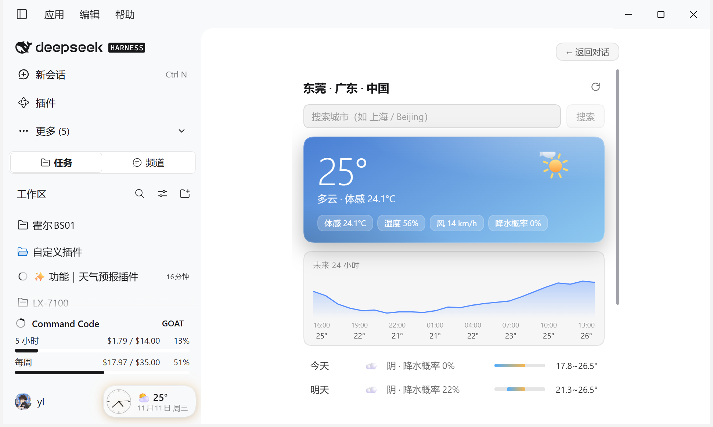

# dsh-weather-badge · 天气预报插件

DeepSeek Harness（DSH）自定义插件：**Agent 工具 + 账号旁时钟天气徽章**。

- **时钟 + 天气表盘（打开界面直接显示，无需任何点击）**：侧栏底部**账号右侧**并排两枚表盘——衬线数字时钟（走秒）与天气表盘（天气图标 / 当前温度 / 湿度环）；账号下方一条横排信息条显示 `日期 · 星期`。点任一表盘在主区域展开完整天气面板，面板左上角「← 返回对话」回到对话。
- **左侧栏天气面板**：左侧栏图标列有天气图标，点一下天气卡片直接显示在主界面（与「插件」「定时任务」面板同一机制）。
- **右侧栏天气标签页**：右侧 Sidebar 引导页也有「天气预报」入口，可停靠/浮窗查看。
- **`weather` 工具（模型可调用）**：对话里问"明天上海穿什么"，模型会调用本工具查询实时天气与逐日预报，再组织回答。

数据来自三级自动切换的免费源：先 [Open-Meteo](https://open-meteo.com/)（无需 API Key，字段最全），失败退到 [MET Norway](https://api.met.no/)（CC-BY 4.0，10 天逐小时），再退到 [wttr.in](https://wttr.in/)（3 天、3 小时一档）；失败的源冷却 10 分钟不再重试，三家全挂时显示上次成功的缓存并标注「离线缓存」。城市搜索走 Open-Meteo geocoding，失败退 [Photon](https://photon.komoot.io/)，支持直接搜镇名（如「塘厦」/「塘厦镇」）；自动定位按公网 IP 取座标后，再用 [BigDataCloud](https://www.bigdatacloud.com/) 反向地理编码细化到乡镇/街道级（如「南城街道」「塘厦镇」），IP 服务依次回落 ipwho.is → geojs.io → ipinfo.io → ipapi.co；面板标题栏的「精确定位」按钮优先用系统 GPS 拿更准的座标；显示时间可切换为网络时间（timeapi.io，备用 Cloudflare trace）。主源的 WMO 天气码只按降水/能见度分档，另用实时云量把「晴 / 基本晴 / 多云 / 阴」纠正到更贴近体感的档位并展示云量百分比；复合地名（如「梅州兴宁市」）在两家源都无结果时会自动拆词重试；IP 定位结果在面板页脚提示可能与实际所在地不符。

## 界面预览

侧栏底部账号右侧的常驻表盘（时钟 + 天气），账号下方是日期条：


完整天气面板（右上角「设置」可展开表盘主题、字体、时间源、日期条与两个表盘的形状）：



## 使用

### 对话中（Agent 工具）

直接问天气即可，例如：

- 「今天天气怎么样？」→ 自动按网络位置细化到乡镇 / 街道
- 「查一下东京未来 5 天的天气」

工具参数：

| 参数 | 类型 | 说明 |
|---|---|---|
| `city` | string | 城市或乡镇名（中文/英文/拼音均可，如 上海 / 塘厦镇；「梅州兴宁市」这类复合地名会自动拆词重试）。省略时按网络位置细化定位（页脚会提示可能不在实际所在地） |
| `days` | integer | 预报天数 1–7，默认 3 |

### 界面显示

- **账号旁表盘（默认开启）**：侧栏底部账号右侧常驻两枚 64px 表盘，无需点击即可看到时间与当天天气；点任一表盘展开完整天气面板。
  - **时钟表盘**：12 个方位为阿拉伯衬线数字（等宽对齐，字体随「字体」设置切换：楷体 / 宋体 / Times / 黑体 / 等宽），12 / 3 / 6 / 9 用暖金强调；时针、分针、秒针分层粗细递增，针尖不接触数字。
  - **天气表盘**：上排天气图标、中间温度（单字符 ℃）、底部湿度进度条与百分比；底色按天气种类取三段浅→深同色系渐变（晴暖黄、夜蓝紫、雨蓝、雪青白、雷紫等）。
  - 账号下方是**日期条**：一条横排的「日期 · 星期」（如 2026年11月13日 · 星期五），可整条关闭。
  - 整体扁平化融入 Harness 界面：透明底、无发光 / 毛玻璃 / 投影，仅 hover 时淡灰底；徽章容器固定宽度，不会随每秒走秒重排。
  - **可切换的表盘主题**：天气面板「设置」里的「表盘主题」一行可选 6 款——白金 / 雾蓝 / 暖米 / 薄紫 / 石墨 / 青瓷。每款是完整的圆盘画面：白色到同色系浅彩的多段径向渐变面料 + 顶部高光 + 一道外圈细边 + 60 格刻度（每 5 格加粗）+ 12/3/6/9 暖金衬线数字 + 锥形指针（时针深墨、分针同色系、秒针红），浅色五款白底深字清晰可读，石墨款为深色底盘配浅字。全部为内联矢量，不依赖图片资源。选择写入 localStorage（dsh-weather-badge.dial.v3），账号旁徽章与面板预览即时同步，默认「白金」；
  - **字体可切换**：面板「字体」一行可选楷体 / 宋体 / Times / 黑体 / 等宽，徽章文字与表盘数字同步生效（localStorage `dsh-weather-badge.font.v1`）；
  - **数据源**：天气与预报按 Open-Meteo → MET Norway → wttr.in 三级自动切换（met.no 的 symbol_code 与 wttr 的 WWO 码都统一映射成 WMO 码，界面与徽章不分数据源一致显示）；失败源冷却 10 分钟，避免每次卡在超时上；三家全挂时回退到 localStorage 里最近一次成功的数据，页脚标注「离线缓存」。城市搜索 Open-Meteo geocoding → Photon（可搜镇名）；IP 定位依次回落 ipwho.is → geojs.io → ipinfo.io → ipapi.co，座标再经 BigDataCloud 反向编码细化到乡镇/街道，并支持「精确定位」按钮走系统 GPS；时间校准来自 timeapi.io（备用 Cloudflare trace），任何一家不可用都会自动换下一家；面板页脚会显示本次数据来自哪一家（MET Norway 按其 CC-BY 4.0 要求署名）；天气码会按实时云量纠正，界面显示云量百分比；IP 定位在页脚提示可能不在实际所在地；复合地名搜不到时自动拆词重试（如「梅州兴宁市」→「梅州 兴宁市」）
- **设置收纳**：面板里的表盘主题、字体、时间源、日期条、两个表盘形状全部收进「设置」抽屉，点一下标题展开、再点收起，默认收起，展开状态记在 localStorage `dsh-weather-badge.settings-open.v1`；
- **时间源可切换**：面板「时间源」一行可选本机 / 网络——选网络时向授时接口取 UTC 与本机时钟的偏差并叠加到显示时间上，本机时钟不准也不会走偏，每 10 分钟重新校准一次；取不到网络时间时自动回退本机时钟。开关写入 localStorage `dsh-weather-badge.nettime.v1`，默认开启；
  - **时钟表盘形状可切换**：面板「时钟表盘」一行可选圆形 / 方形——方形是同一套渐变、外框、内衬与高光的圆角卡片版本，指针与数字位置不变，选择写入 localStorage `dsh-weather-badge.clockshape.v1`，默认圆形（主题缩略图同步跟随）；
  - **天气表盘形状可切换**：面板「天气表盘」一行可选圆形 / 方形——圆形与时钟表盘同规格（投影、外圈、内衬环、高光），方形为圆角卡片。两种布局内容一致（图标 / 温度 / 湿度进度条），选择写入 localStorage `dsh-weather-badge.wxshape.v1`，默认圆形；
  - **日期条可开关**：面板「日期条」一行选显示 / 隐藏。隐藏后账号下方那条「日期 · 星期」整条不渲染，不占高度（localStorage `dsh-weather-badge.info.v1`）；
- **左侧栏面板**：左侧栏图标列点**天气图标**，同样在主界面显示完整面板。
- **右侧栏标签页**：打开右侧 Sidebar → 引导页点「天气预报」；可停靠分栏或拖出浮窗。
- 首次打开自动按网络位置细化到乡镇 / 街道；点面板标题栏「精确定位」按钮可用系统 GPS 拿到更准的座标；也可直接在搜索框输入城市或乡镇名切换（如「塘厦镇」，选择会记住，存在浏览器 localStorage）；
- 徽章与卡片共享一份 5 分钟预报缓存；打开期间每 30 分钟自动刷新。

## 配置

在 `~/.dsh/profiles/desktop/cordis.patch.yml` 中覆盖本插件条目的 `config`（注意：patch 层是整体替换 `config`，未写的字段回到代码默认值）：

```yaml
- id: dsh-weather-badge
  config:
    toolName: weather      # 工具名，默认 weather
    defaultCity: 上海       # 固定默认城市；设置后工具不再按 IP 定位（卡片仍可搜索切换）
    days: 3                # 工具默认预报天数 1-7
```

## 开发与测试

仓库自带无头单测：用 `node:vm` 装载整份 `lib/client.js`，以最小 DOM / React 替身跑组件，校验表盘主题、指针与数字、圆/方轮廓、时间解析、三级预报源切换与冷却、离线缓存、反向地理编码细化到乡镇/街道、镇名搜索回落、复合地名拆词重试与云量纠正天气码，不需要打开 GUI。

```bash
node --test "tests/*.test.mjs"
```

## 安装

### 从 Git 安装（最新代码）

在 DSH 的**插件 → 已安装 → 添加插件**里选择「从链接安装」，填入：

```
git+https://github.com/henry1996-yl/dsh-weather-badge
```

要固定到某个提交（推荐，避免跟到未测试的改动）：

```
git+https://github.com/henry1996-yl/dsh-weather-badge#<40 位提交 SHA>
```

也可以在终端里安装：

```bash
dsh plugin --profile desktop add git+https://github.com/henry1996-yl/dsh-weather-badge
```

### 通过插件市场索引安装

本仓库自带一份符合插件市场索引格式 1 的索引文件 [`market/index.json`](market/index.json)。在**插件 → 发现 → 添加索引源**里填入它的地址：

```
https://cdn.jsdelivr.net/gh/henry1996-yl/dsh-weather-badge@main/market/index.json
```

如果 jsDelivr 不可用，可以改用 GitHub 直连地址：

```
https://raw.githubusercontent.com/henry1996-yl/dsh-weather-badge/main/market/index.json
```

添加后「发现」页即可搜到「天气徽章与时钟表盘」并直接安装；索引里固定了提交 SHA，安装的就是这份 README 对应的版本。

### 本地开发挂载

在 `~/.dsh/profiles/desktop/cordis.yml` 或 `package.json` 的 `bundles` 里把本目录作为 `link:` 依赖加入，然后重启 DSH 或禁用→启用本插件。

安装/更新后在**插件**页把本插件禁用再一次启用即可生效（无需重启应用）。
## 卸载

在插件管理里移除 `dsh-weather-badge` 即可；工具与侧栏卡片随插件停用一起消失。

## 实现说明

- **零依赖**：宿主端（`lib/index.js`）只用 Node 内置能力，注册原生 JSON-Schema 工具定义；客户端（`lib/client.js`）按 DSH 的 lazy-CJS bundle 协议手写，无需构建步骤。
- **宿主端**：`inject: ['tools']`，`ctx.tools.register(...)` 注册 `weather` 工具；与客户端共用同一套三级源（Open-Meteo → MET Norway → wttr.in）与冷却逻辑，城市搜索 Open-Meteo → Photon，两端都会对复合地名做拆词重试；IP 定位后同样用 BigDataCloud 反向编码细化到乡镇/街道并输出 admin2；并用云量纠正主源的晴/多云天气码（工具输出带 cloudCover 字段）。
- **客户端**：`inject: ['slots', 'locale', 'sidebarRightTabs', 'sidebarRight']`，向右侧栏注册 `weather` 页类型 + 引导页入口，正文组件直接从浏览器请求上面三家源（都带 `Access-Control-Allow-Origin: *`，无需宿主代理）；另用 `ctx.inject(['layout'])` 拿布局句柄，实现徽章 ↔ 主面板切换。
- **账号旁徽章**：`settings.launcher` 席位只容纳账号菜单、没有并列扩展位，因此徽章按社区插件的 DOM 注入方式实现——找到 `div[class*="triggerRow"]` 里的账号按钮，在其后插入 `div.dshw-chip-host`（React 18 `createRoot` 渲染）；容器可收缩（`flex:0 1 auto` + `min-width:0`），窄栏时压缩自身而不是溢出盖住账号；侧栏折叠成图标栏（宽度 < 150px）时整枚徽章隐藏；`MutationObserver` 跟随重渲染重新落位，插件停用时 `unmount` + 移除节点。
- 中英文文案随界面语言切换（`zh` / `en` 词典内置于客户端 bundle）。

## 已知限制

- 公网 IP 定位只能拿到市级座标，乡镇/街道名依赖 BigDataCloud 反向地理编码（CORS 开放、无需 API Key）；IP 出口常与实际所在地不同（例如出口在「南城街道」而人在「塘厦镇」），要精确到某个镇请直接搜索镇名（如「塘厦镇」）或点「精确定位」用系统 GPS。反向服务不可用时自动退回市级名，卡片提示改用城市搜索，工具提示传 `city` 参数。WMO 天气码只按降水/能见度分档，界面按实时云量把晴/多云类纠正到更贴近体感的档位（云量 ≥85 阴、≥40 多云、≥15 基本晴），并展示云量百分比；天气预报本身仍可能与体感有偏差。
- 三家源都是第三方公共服务，极端情况下可能限流；任一限流会自动切换，全部不可用则显示缓存。
- MET Norway 数据许可为 [CC-BY 4.0](https://www.met.no/en/About-us/service-and-data-policy)，按许可要求在面板页脚与 `weather` 工具输出里署名。