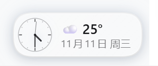

# dsh-weather-badge · 天气预报插件

DeepSeek Harness（DSH）自定义插件：**Agent 工具 + 账号旁时钟天气徽章**。

- **时钟 + 日期 + 天气徽章（打开界面直接显示，无需任何点击）**：嵌在侧栏底部**账号（头像/名称）右侧**，常驻显示 `圆形走秒时钟` + `日期/星期` + `天气图标 + 当前温度`。点徽章在主区域展开完整天气面板，面板右上角「← 返回对话」回到对话。
- **左侧栏天气面板**：左侧栏图标列有天气图标，点一下天气卡片直接显示在主界面（与「插件」「定时任务」面板同一机制）。
- **右侧栏天气标签页**：右侧 Sidebar 引导页也有「天气预报」入口，可停靠/浮窗查看。
- **`weather` 工具（模型可调用）**：对话里问"明天上海穿什么"，模型会调用本工具查询实时天气与逐日预报，再组织回答。

数据来自 [Open-Meteo](https://open-meteo.com/)（免费、无需 API Key）；自动定位按公网 IP 粗略定位（ipwho.is → ipapi.co 依次尝试）。

## 界面预览

侧栏底部账号右侧的常驻徽章（圆形走秒时钟 + 日期/星期 + 天气图标与当前温度）：



## 使用

### 对话中（Agent 工具）

直接问天气即可，例如：

- 「今天天气怎么样？」→ 自动按 IP 定位
- 「查一下东京未来 5 天的天气」

工具参数：

| 参数 | 类型 | 说明 |
|---|---|---|
| `city` | string | 城市名（中文/英文/拼音均可）。省略时按 IP 粗略定位 |
| `days` | integer | 预报天数 1–7，默认 3 |

### 界面显示

- **账号旁徽章（默认开启）**：侧栏底部账号右侧常驻一枚实时时钟 + 天气徽章，无需点击即可看到当天天气；点击展开完整天气面板。徽章为三行等大 12px 文字：
  - 第一行：天气图标 + 中文天气 + 温度 + 湿度（如 ☀️ 晴 24℃ 💧52%），温度用单个 ℃ 字符；
  - 第二行：完整日期（如 2026年11月12日）；
  - 第三行：长星期名 + 实时秒针时钟（如 星期四 14:27:38）。
  - 时钟是**衬线数字表盘**：12 个方位全部为阿拉伯衬线数字（等宽对齐，Font stack 走楷体 / 宋体 / Georgia / Times New Roman），12 / 3 / 6 / 9 用暖金 #a9812f 强调；时针、分针、秒针长度层级为 20 < 26 < 29，针尖不接触数字；表盘底色随天气主题变化。
  - 整体扁平化融入 Harness 界面：透明底、无发光 / 毛玻璃 / 投影，仅 hover 时淡灰底。
  - **可切换的表盘主题**：完整天气面板顶部「表盘主题」一行可选 6 款——白金 / 雾蓝 / 暖米 / 薄紫 / 石墨 / 青瓷。每款是完整的圆盘画面：白色到同色系浅彩的多段径向渐变面料 + 顶部高光 + 一道外圈细边 + 60 格刻度（每 5 格加粗）+ 12/3/6/9 暖金衬线数字 + 锥形指针（时针深墨、分针同色系、秒针红），浅色五款白底深字清晰可读，石墨款为深色底盘配浅字。全部为内联矢量，不依赖图片资源。选择写入 localStorage（dsh-weather-badge.dial.v3），账号旁徽章与面板预览即时同步，默认「白金」；
  - **字体可切换**：面板「字体」一行可选楷体 / 宋体 / Times / 黑体 / 等宽，徽章文字与表盘数字同步生效（localStorage `dsh-weather-badge.font.v1`）；
  - **天气表盘**：与时钟表盘并排的圆形盘面——上排天气图标、中间温度（单字符 ℃）、底部湿度进度条与百分比。底色按天气种类取三段浅→深同色系渐变（晴暖黄、夜蓝紫、雨蓝、雪青白、雷紫等），与时钟表盘同一套外框细边、顶部高光与衬线数字风格；
  - **天气表盘形状可切换**：面板「天气表盘」一行可选圆形 / 方形——圆形与时钟表盘同规格（投影、外圈、内衬环、高光），方形为圆角卡片。两种布局内容一致（图标 / 温度 / 湿度进度条），选择写入 localStorage `dsh-weather-badge.wxshape.v1`，默认圆形；
  - **日期条可开关**：面板「日期条」一行选显示 / 隐藏。隐藏后账号下方那条「日期 · 星期」整条不渲染，不占高度（localStorage `dsh-weather-badge.info.v1`）；
- **左侧栏面板**：左侧栏图标列点**天气图标**，同样在主界面显示完整面板。
- **右侧栏标签页**：打开右侧 Sidebar → 引导页点「天气预报」；可停靠分栏或拖出浮窗。
- 首次打开自动按 IP 定位；也可在搜索框输入城市切换（选择会记住，存在浏览器 localStorage）；
- 徽章与卡片共享一份 5 分钟预报缓存；打开期间每 30 分钟自动刷新。

## 配置

在 `~/.dsh/profiles/desktop/cordis.patch.yml` 中覆盖本插件条目的 `config`（注意：patch 层是整体替换 `config`，未写的字段回到代码默认值）：

```yaml
- id: dsh-weather-badge
  config:
    toolName: weather      # 工具名，默认 weather
    defaultCity: 上海       # 固定默认城市；设置后工具不再按 IP 定位（卡片仍可搜索切换）
    days: 3                # 工具默认预报天数 1-7
```

## 卸载

在插件管理里移除 `dsh-weather-badge` 即可；工具与侧栏卡片随插件停用一起消失。

## 实现说明

- **零依赖**：宿主端（`lib/index.js`）只用 Node 内置能力，注册原生 JSON-Schema 工具定义；客户端（`lib/client.js`）按 DSH 的 lazy-CJS bundle 协议手写，无需构建步骤。
- **宿主端**：`inject: ['tools']`，`ctx.tools.register(...)` 注册 `weather` 工具；地理编码与预报均走 Open-Meteo。
- **客户端**：`inject: ['slots', 'locale', 'sidebarRightTabs', 'sidebarRight']`，向右侧栏注册 `weather` 页类型 + 引导页入口，正文组件直接从浏览器请求 Open-Meteo（其 API 支持 CORS）；另用 `ctx.inject(['layout'])` 拿布局句柄，实现徽章 ↔ 主面板切换。
- **账号旁徽章**：`settings.launcher` 席位只容纳账号菜单、没有并列扩展位，因此徽章按社区插件的 DOM 注入方式实现——找到 `div[class*="triggerRow"]` 里的账号按钮，在其后插入 `div.dshw-chip-host`（React 18 `createRoot` 渲染）；容器可收缩（`flex:0 1 auto` + `min-width:0`），窄栏时压缩自身而不是溢出盖住账号；侧栏折叠成图标栏（宽度 < 150px）时整枚徽章隐藏；`MutationObserver` 跟随重渲染重新落位，插件停用时 `unmount` + 移除节点。
- 中英文文案随界面语言切换（`zh` / `en` 词典内置于客户端 bundle）。

## 已知限制

- IP 定位是粗略的（市级），且依赖第三方定位服务的可用性；失败时卡片会提示改用城市搜索，工具会提示传 `city` 参数。
- Open-Meteo 免费额度对个人使用足够，但它是第三方公共服务，极端情况下可能限流。
